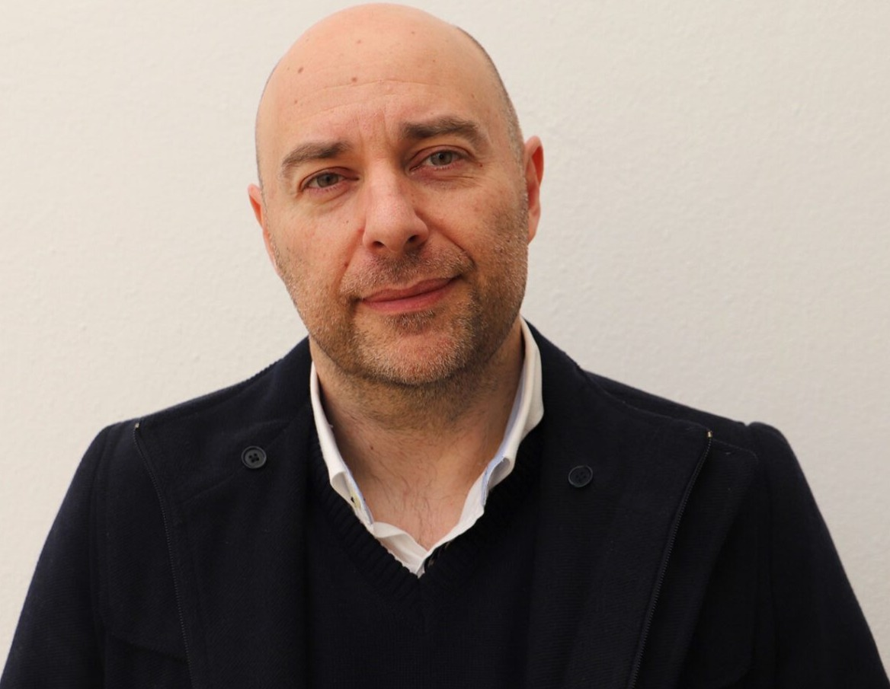

-   **Função atual** | Investigador Contratado
-   **Local** | CIAC - Faculdade de Ciências Humanas e Sociais  
-   **Campus** | Gambelas
-   **Sobre mim** | "Sou algarvio e faço parte da comunidade da UAlg desde 1994. Licenciei-me em Estudos Portugueses na FCHS e, em 2014, concluí o doutoramento em Comunicação, Cultura e Artes com uma bolsa da FCT.  Atualmente, sou investigador contratado no CIAC. Este percurso deu-me a oportunidade de conhecer de perto as diferentes realidades da Universidade e reforçou o meu compromisso com o diálogo, a proximidade e a representação de todos os trabalhadores."
-   **A minha visão para a Comissão de Trabalhadores da UAlg** | "Acredito numa Comissão de Trabalhadores próxima das pessoas, que ouça, dialogue e represente verdadeiramente todos. Uma comissão que defenda melhores condições de trabalho, valorize cada profissional e ajude a encontrar, em conjunto, soluções práticas para uma UAlg mais inclusiva e participativa."

